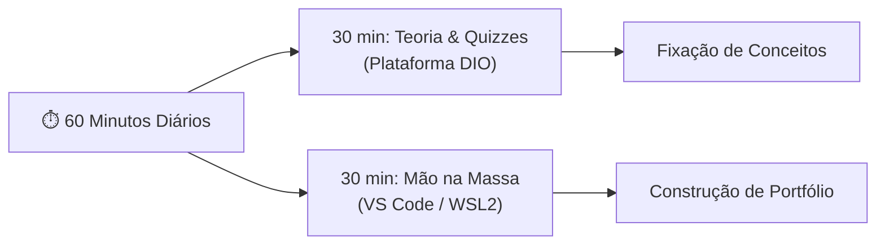

# 🚀 Plano de Estudos: Transição para Análise de Dados & IA (30 Dias)

> **Foco:** Construir uma base sólida e prática em Análise de Dados e Inteligência Artificial, dedicando **1 hora por dia**, conectando teoria, prática de código e visão estratégica de negócio.

---

## 📌 Visão Geral e Contexto

Este plano foi customizado para aproveitar a bagagem profissional prévia em **Recursos Humanos (RH)** e **Atendimento ao Cliente / SAC**, associando-a à familiaridade inicial com **Python**. A combinação de entendimento do comportamento humano, empatia com o usuário e raciocínio analítico gera um diferencial competitivo valioso: **a capacidade de traduzir números em decisões estratégicas de negócio**.

O roteiro tem como espinha dorsal a formação aprovada:
* **Trilha Principal:** [Santander Bootcamp - Dados com Python e IA (DIO)](https://web.dio.me/track/a0568308-55de-4e1b-9de6-89aed90a6796)
* **Ambiente de Desenvolvimento:** Local no VS Code (integrado com WSL2 / Python 3)
* **Tempo Dedicado:** 60 minutos diários (30 dias)

---

## ⏱️ Dinâmica da Rotina Diária (60 Minutos)

Para maximizar a retenção sem sobrecarga, o tempo diário é dividido em dois blocos:



1. **30 minutos (Teoria e Fundamentos):** Assistir às aulas e responder aos quizzes conceituais diretamente na plataforma da DIO.
2. **30 minutos (Prática no Teclado):** Replicar códigos, criar scripts, manipular arquivos e testar exemplos reais direto no seu VS Code local.

---

## 🗺️ Visão Geral do Roteiro (Semanas 1 a 4)

| Semana | Foco Temático (DIO) | Conteúdos Centrais | Entrega Prática Esperada |
| :---: | :--- | :--- | :--- |
| **01** | **Fundamentos de Python & Estruturas de Dados** | Sintaxe, tipos de dados, condicionais, loops, tuplas, listas e dicionários. | Scripts de automação simples e filtros de dados em memória. |
| **02** | **POO e Manipulação de Arquivos** | Classes, métodos, tratamento de erros (`try/except`) e I/O de arquivos (`.txt`, `.csv`). | Script para ler registros brutos de atendimento e persistir relatórios tratados. |
| **03** | **Análise e Manipulação com Pandas** | Series, DataFrames, limpeza de valores nulos, filtros avançados e `groupby`. | Análise descritiva completa de uma base de dados tabular (ex: RH/SAC). |
| **04** | **Visualização de Dados & IA Generativa** | Gráficos com Matplotlib/Seaborn, Engenharia de Prompt aplicada e Storytelling. | Projeto prático final integrado com dashboard visual e insights acionáveis. |

---

## 📂 Estrutura de Arquivos deste Repositório

```text
├── README.md                 <- Este documento: visão geral, objetivos e metodologia.
├── cronograma.md             <- Roteiro dia a dia detalhado (dias 1 ao 30).
├── recursos.md               <- Links, referências e ferramentas divididos por semana.
├── anotacoes/                <- Diários de estudo e anotações semanais.
│   └── semana-01.md          <- Modelo padrão da Semana 1 (duplicável para 02, 03, etc.).
└── Transição para Análise de Dados.pdf <- Documento base original do copiloto.
```

---

## 🧭 Como Usar este Plano

1. Consulte o [cronograma.md](cronograma.md) para saber exatamente o que estudar a cada dia.
2. Acesse os links e materiais complementares em [recursos.md](recursos.md).
3. Utilize a pasta [`anotacoes/`](anotacoes/) para registrar seu progresso, dúvidas e códigos. Basta duplicar o arquivo [`semana-01.md`](anotacoes/semana-01.md) para as semanas seguintes (`semana-02.md`, etc.).
4. Mantenha a consistência: **1 hora com foco total todos os dias vale mais do que 7 horas acumuladas no fim de semana!**
