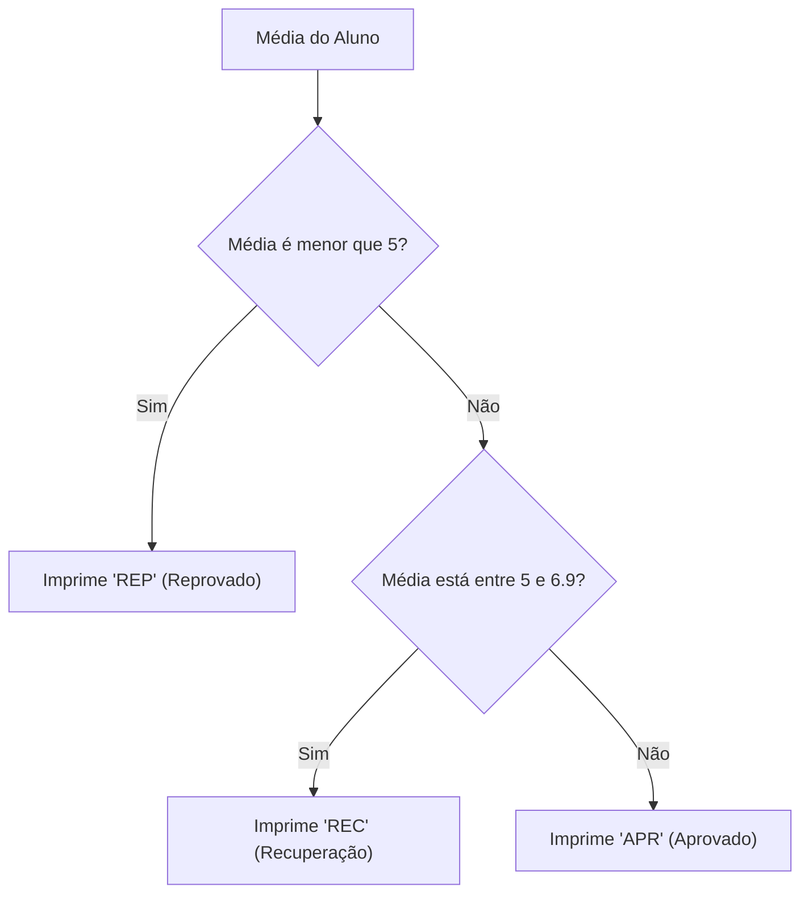

# 📊 Desafio de Código: Média Final do Aluno (DIO)

> Solução comentada e explicada do Desafio de Código da DIO sobre estruturas condicionais e regras de negócio.

---

## 📌 Enunciado do Desafio

Faça um programa que receba a média de um aluno e imprima o seguinte:
* Caso a média seja **< 5**, imprima `"REP"` (Reprovado);
* Caso a média seja **>= 5 e < 7**, imprima `"REC"` (Recuperação);
* Caso a média seja **>= 7**, imprima `"APR"` (Aprovado).

### Exemplos de Entrada e Saída:

| Entrada | Saída Esperada | Classificação |
| :---: | :---: | :--- |
| `5.5` | `REC` | Recuperação |
| `8.0` | `APR` | Aprovado |
| `2.0` | `REP` | Reprovado |

---

## 🧠 Fluxograma Lógico (Árvore de Decisão)

O raciocínio funciona em **cascata**: o computador avalia cada regra de cima para baixo. Assim que encontra a primeira condição verdadeira, ele executa e ignora as demais.



---

## 💻 Soluções Implementadas

### 1. Em JavaScript (Original do Desafio DIO)

Arquivo: [`solucao.js`](solucao.js)

```javascript
// Desafios JavaScript na DIO utilizam "gets" para entrada e "print" para saída
let media = gets();

if (media < 5) {
    print('REP');
} else if (media >= 5 && media < 7) {
    print('REC');
} else {
    print('APR');
}
```

### 2. Em Python (Compatível com o ambiente local e WSL)

Arquivo: [`solucao.py`](solucao.py)

```python
def classificar_media(media: float) -> str:
    if media < 5:
        return "REP"
    elif media >= 5 and media < 7:
        return "REC"
    else:
        return "APR"

# Exemplo de teste
if __name__ == "__main__":
    nota = float(input("Digite a média do aluno: "))
    print(classificar_media(nota))
```

---

## 🔍 Explicação Passo a Passo

1. **`if media < 5` / `SE média < 5`**:
   * Primeira linha de checagem. Se a nota for menor que 5 (por exemplo, `2.0`), o aluno já é classificado como Reprovado e o programa não precisa fazer mais perguntas.
2. **`else if (media >= 5 && media < 7)` / `elif media >= 5 and media < 7`**:
   * O "Senão, se". Só é avaliado se a média **NÃO** for menor que 5.
   * Utiliza o operador lógico `&&` (em JS) ou `and` (em Python) para garantir que a nota atende aos dois limites (estar no intervalo entre 5 e 6.9).
3. **`else` / `Caso Contrário`**:
   * Se a nota não é menor que 5 e nem está abaixo de 7, a única possibilidade matemática restante é ser **7 ou mais**.
   * Não precisa de nova condição: o aluno é automaticamente classificado como Aprovado (`APR`).

---

## 🚀 Como Executar Localmente

No terminal WSL ou Linux:

```bash
python3 desafios-codigo/01-media-final-aluno/solucao.py
```
