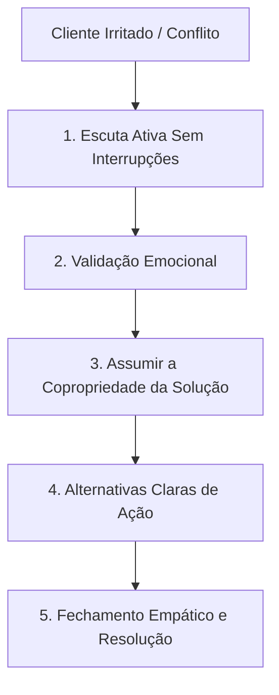

# 🎧 Manual de Sobrevivência do Atendimento ao Cliente: 5 Práticas de Empatia e Desescalada no SAC

> Projeto desenvolvido como parte do desafio **"Natural ou Fake Natty? Como Vencer na Era das IAs Generativas!"** pela [DIO (Digital Innovation One)](https://dio.me).

---

## 📒 Descrição

O **Manual de Sobrevivência do Atendimento ao Cliente** é um guia prático voltado para operadores, atendentes e líderes de SAC/Suporte que lidam diariamente com situações de alta fricção e clientes insatisfeitos. 

Combinando a experiência humana em **Recursos Humanos e Atendimento** com o poder de síntese de **Inteligências Artificiais Generativas**, o projeto traduz conceitos teóricos de comunicação não violenta e inteligência emocional em 5 passos acionáveis para o dia a dia da operação.

---

## 🤖 Tecnologias Utilizadas

- **ChatGPT / Gemini:** Engenharia de prompt aplicada para ideação, estruturação pedagógica e refinamento de tom de voz (empático e profissional).
- **Markdown & Mermaid:** Estruturação visual e fluxo de processo diretamente no repositório.
- **Git & GitHub:** Versionamento, organização e publicação como ativo de portfólio profissional.

---

## 🧐 Processo de Criação

1. **Definição da Persona e Dores:** Identificação dos principais gargalos emocionais e operacionais enfrentados por profissionais de SAC (estresse, clientes agressivos, tempo de atendimento).
2. **Engenharia de Prompt:** Construção de instruções orientadas a contexto para a IA generativa, solicitando técnicas comprovadas de desescalada de conflito e linguagem positiva.
3. **Curadoria Humana:** Refinamento crítico do conteúdo gerado pela IA para eliminar respostas genéricas e garantir que as dicas fossem 100% aplicáveis à realidade do mercado brasileiro de atendimento.
4. **Estruturação do Manual:** Organização visual em tópicos claros, com exemplos práticos do "O que falar" vs. "O que evitar".

---

## 🚀 Resultados: O Manual

### 1. Escuta Ativa e Respiro Estratégico
* **Princípio:** O cliente irritado precisa primeiro desabafar antes de conseguir ouvir uma solução lógica.
* **Na prática:** Permita que o cliente conclua o raciocínio sem interrupções nos primeiros 40 segundos.
* **O que dizer:** *"Compreendo perfeitamente a sua frustração, Sr(a). Fulano. Estou aqui focado para resolver isso com você."*

### 2. Validação do Sentimento (Empatia Real)
* **Princípio:** Não discuta com a emoção do cliente. Valide o impacto do problema antes de justificar processos.
* **O que evitar:** *"O senhor precisa entender que a nossa política da empresa não permite..."*
* **O que dizer:** *"Se estivesse no seu lugar, também me sentiria assim. Vamos encontrar a melhor saída juntos."*

### 3. Comunicação Positiva e Foco no que É Possível
* **Princípio:** Substitua negativas absolutas por caminhos alternativos viáveis.
* **O que evitar:** *"Não posso fazer isso agora."*
* **O que dizer:** *"O que eu já posso adiantar para você imediatamente é [Ação X], enquanto dou entrada em [Ação Y]."*

### 4. Clareza e Transparência de Prazos
* **Princípio:** A ansiedade do cliente aumenta com prazos vagos.
* **Na prática:** Estabeleça expectativas realistas em vez de prometer o impossível para encerrar o chamado rápido.
* **O que dizer:** *"Vou acompanhar esse protocolo internamente e o retorno oficial será enviado até as 16h de hoje."*

### 5. Encerramento com Sensação de Amparo
* **Princípio:** O final do atendimento define a nota de satisfação (CSAT) e a fidelidade da marca.
* **O que dizer:** *"Ficou alguma dúvida além desse chamado? Meu nome é [Seu Nome] e conte sempre com a nossa equipe."*

---

## 💭 Reflexão (Natty or Not)

O verdadeiro desafio de criar algo *"Natty"* (que soe autêntico, humano e natural) com IA Generativa está na **curadoria humana**. 

A IA tem uma capacidade impressionante de sintetizar informações em segundos, mas sem o direcionamento de quem viveu a dor de um atendimento real, o resultado pode soar frio ou robótico. A união da tecnologia com a sensibilidade humana é a verdadeira chave para vencer na era das IAs generativas!
